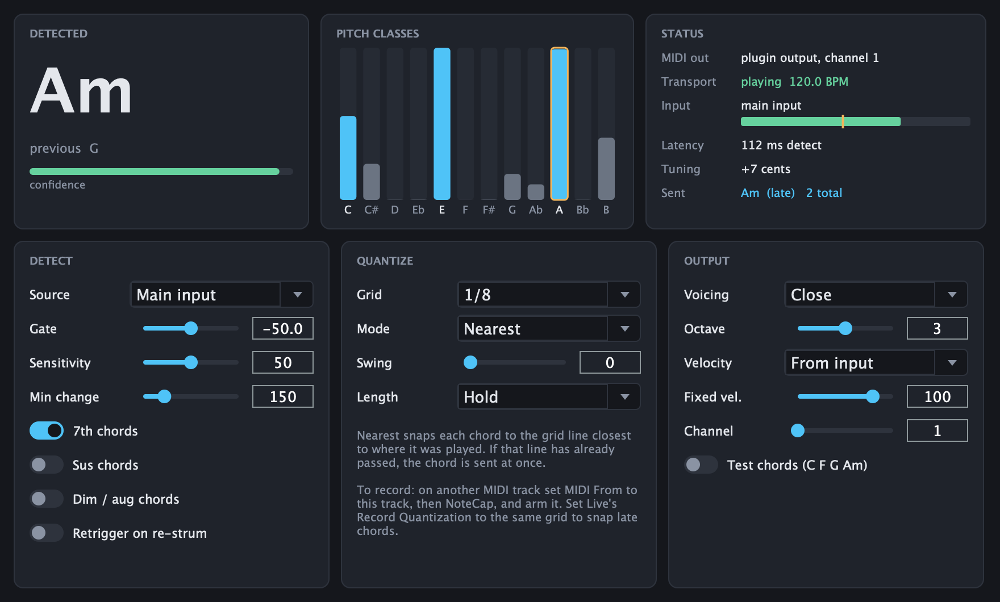

# NoteCap

A VST3 plugin for Ableton Live that listens to audio (a guitar, keys or a mic),
recognises the chord being played, and sends it as **quantized MIDI** that a
MIDI track can record. Built with JUCE. Also builds as a Standalone app for
testing.



See [PLAN.md](PLAN.md) for the full project plan and design decisions.

## How it fits into Live

NoteCap sits on the track you're playing into and sends its chords out as the
plugin's MIDI output. A MIDI track records them with Live's standard
[plug-in MIDI output routing](https://help.ableton.com/hc/en-us/articles/209070189-Accessing-the-MIDI-output-of-a-VST-plug-in).
In Live 12 that route is sample-accurate.

```
Audio track "Guitar"   input: your interface / mic, Monitor: In or Auto
  [ NoteCap ]          Source: Main input (audio passes through unchanged)
        │ plug-in MIDI output
        ▼
MIDI track "Chords"    MIDI From: Guitar → NoteCap   (armed)
  [ Wavetable (or any instrument) ]
```

1. **Settings → Plug-Ins:** turn on **Use VST3 Plug-In System Folders**. Rescan
   if NoteCap doesn't appear in the browser under Plug-Ins.
2. Put **NoteCap** on the audio track you play into, with *Source* set to
   **Main input** (the default).
3. On a MIDI track with any instrument, set **MIDI From** to that audio track,
   then pick **NoteCap** in the chooser below it, not *Pre FX* or *Post FX*.
   Arm the MIDI track.
4. Play. The detected chord appears in NoteCap and the instrument plays it on
   the grid. Press record to capture it.
5. Recommended: set **Edit → Record Quantization** to the same grid as NoteCap,
   to snap chords that were detected after their grid line (see below).

*Source: Sidechain* is for putting NoteCap on a different track from the one it
listens to. Pick the audio track in NoteCap's **Sidechain** section of the
device header.

## Controls

| Group | Control | What it does |
|---|---|---|
| Detect | Source | Main input (default) or the sidechain |
| | Gate | Input below this level counts as silence and releases the chord |
| | Sensitivity | Higher detects more readily; lower needs a clearer chord |
| | Min change | How long a chord change without a new strum must last (legato playing) |
| | 7th / Sus / Dim-aug | Chord vocabulary. Triads are always on |
| | Retrigger | Re-send the chord when the same chord is strummed again |
| Quantize | Grid | Off, 1 bar … 1/16, plus triplets |
| | Mode | **Nearest**: the grid line closest to the strum. **Next line**: always the next line after detection. Always audibly on the grid, but can be one line late |
| | Swing | Delays every other grid line |
| | Length | Hold until the next chord, or a fixed 1/2/4/8 grid steps |
| Output | Voicing / Octave | Close, open, or bass + chord. Octave uses Live's naming (C3 = middle C) |
| | Velocity | From the input level, or fixed |
| | Channel | MIDI channel 1–16 |
| | Test chords | Ignores audio and plays C F G Am on every grid line. Use it to check routing and timing |

**On quantizing in real time:** a chord can only be recognised about 110–200 ms
after the strum, so it can't be moved *earlier*. In *Nearest* mode, if the
chord's grid line is still ahead, the chord is sent exactly on it. If the line
has already passed, the chord is sent at once and arrives late. Live's
**Record Quantization** snaps it back when it's less than half a grid step late.
Coarse grids (1/4, 1/2, bar) usually catch the line; at 1/16 most chords are late.

## Phase 0 checklist (verify in your Live 12)

Chordism's LiveBridge tests already measured the VST3 *MIDI From* route in Live
12.4.6 as sample-accurate. These checks are specific to NoteCap:

- [ ] **Routing + timing (Test chords):** turn on *Test chords*, Grid 1/4, press
      play and record 8 bars on the MIDI track. Chords should be C F G Am, each
      exactly on its beat.
- [ ] **Detection:** play into the audio track. The Status panel shows
      `Input: main input` with a moving meter, and the chords you play are
      recorded.
- [ ] **Sidechain (optional):** with NoteCap on another track and *Source* set
      to Sidechain, choose the guitar track in the Sidechain section. Status
      should not say "sidechain not connected".
- [ ] **Late chords:** Grid 1/4, Mode Nearest, Record Quantization on 1/4.
      Strum on the beat and record: the chords land on the beat.
- [ ] Save the set, close Live and reopen it: NoteCap's settings and the MIDI
      track's *MIDI From* routing are restored.

## Building

Requires Xcode and a JUCE 8 checkout at `~/Development/JUCE` (no brew, no cmake).

```sh
# regenerate the Xcode project after editing NoteCap.jucer
~/Development/JUCE/extras/Projucer/Builds/MacOSX/build/Release/Projucer.app/Contents/MacOS/Projucer \
    --resave NoteCap.jucer

# build VST3 + Standalone (copies the VST3 to ~/Library/Audio/Plug-Ins/VST3)
xcodebuild -project Builds/MacOSX/NoteCap.xcodeproj -target "NoteCap - All" -configuration Release build

# validate with Tracktion's pluginval (https://github.com/Tracktion/pluginval)
pluginval --strictness-level 10 --validate ~/Library/Audio/Plug-Ins/VST3/NoteCap.vst3
```

If Live doesn't list it, rescan in Preferences → Plug-Ins.

## Installer

```sh
Tools/package.sh              # Release build -> dist/NoteCap-<version>.pkg
Tools/package.sh --no-build   # package the existing Release build
```

The installer puts `NoteCap.vst3` in `/Library/Audio/Plug-Ins/VST3`. CI builds
the same package on every push (the *NoteCap-installer* artifact).

Without extra setup the plugin is **ad-hoc signed**. That works on the Mac
that built them, but Gatekeeper blocks the package on other Macs. To
distribute it, get **Developer ID Application** and **Developer ID Installer**
certificates (Apple Developer Program), then:

```sh
xcrun notarytool store-credentials notecap --apple-id you@example.com --team-id TEAMID
DEVELOPER_ID_APP="Developer ID Application: Your Name (TEAMID)" \
DEVELOPER_ID_INSTALLER="Developer ID Installer: Your Name (TEAMID)" \
NOTARY_PROFILE=notecap Tools/package.sh
```

This signs with the hardened runtime, notarizes and staples the package.

**Dev builds and the installer don't mix:** Xcode builds copy the plugin into
`~/Library/Audio/Plug-Ins/VST3`, and the installer puts it in
`/Library/Audio/Plug-Ins/VST3`. With both present, Live may load either one.
Remove one of the two.

## Tests

```sh
Tests/run_tests.sh          # core DSP: classifier, quantizer, voicing, engine + randomised benchmark
Tests/run_integration.sh    # real processor + fake transport, checks its MIDI output (needs a Release build)
```

The integration test also covers these hardening checks:
- no heap allocation inside `processBlock`;
- no stuck notes after a transport stop, bypass, or a host `reset()` /
  `releaseResources()` (the note-offs go out on the next block);
- recovery from NaN/Inf input;
- four instances processing at once on separate threads, with no crosstalk;
- a state saved by the earlier build, which still had the virtual port's
  settings, loads cleanly.

The engine benchmark renders 300 synthetic strummed-guitar chords at 44.1, 48
and 96 kHz, with random tuning and strum speeds. Current result: **98.7%
majmin** / 92% exact-label accuracy, about 130 ms mean decision latency.

## Testing in Live (LiveBridge)

`LiveBridge/` drives a running Live 12 through a Remote Script (**NoteCapBridge**, port 9872).
It builds tracks, loads NoteCap, sets its parameters, routes *MIDI From*, records, and reads
the recorded notes back with their exact timing. It's also an MCP server (`.mcp.json`), so
Claude can drive Live directly. It comes from Chordism's LiveBridge.

```sh
cd LiveBridge && uv sync && ./install_remote_script.sh
# restart Live; Settings → Link, Tempo & MIDI → Control Surface: NoteCapBridge
uv run pytest tests/test_routing_live.py     # Test chords via MIDI From: right chords, 0.000 ms
uv run pytest tests/test_detection_live.py   # Chordism → Drift → NoteCap: detection + latency
```

See [LiveBridge/README.md](LiveBridge/README.md) for the commands and the protocol.

## Evaluating on your own recordings

```sh
Tools/eval/build.sh
Tools/eval/build/notecap_eval take.wav              # prints a .lab of detected chords
Tools/eval/build/notecap_eval take.wav take.lab     # + majmin accuracy vs a reference
```

Reference `.lab` files use `start end label` lines with Harte labels
(`A:min`, `G:7`, `N`). You can make them by hand or export from Sonic
Visualiser.

## Layout

```
Source/core/     pure C++ DSP (no JUCE): chroma (NNLS), onset, classifier, engine, quantizer, voicing
Source/          PluginProcessor (scheduling, transport), PluginEditor (UI)
Tests/           unit tests, engine benchmark, integration test, editor snapshot
Tools/eval/      offline evaluator for WAV + .lab
LiveBridge/      Live-in-the-loop tests and MCP server (Remote Script + Python client)
```
